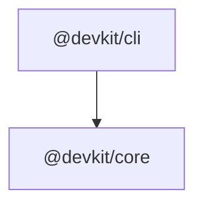

# Architecture

> Generated by the nightly maintenance workflow. Do not edit by hand.

This repository is a pnpm workspace. The diagram below shows how the
published packages depend on each other.

## Packages

| Package | Version | Responsibility |
| --- | --- | --- |
| `@devkit/cli` | 0.1.0 | CLI entry point for devkit |
| `@devkit/core` | 0.1.0 | Core utilities and shared types for devkit |

## Workspace dependencies

- **@devkit/cli**: @devkit/core, commander
- **@devkit/core**: no runtime dependencies
