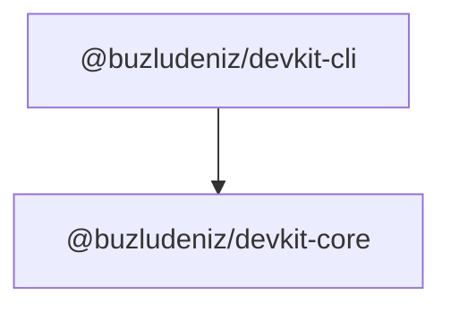

# Architecture

> Generated by the nightly maintenance workflow. Do not edit by hand.

This repository is a pnpm workspace. The diagram below shows how the
published packages depend on each other.

## Packages

| Package | Version | Responsibility |
| --- | --- | --- |
| `@buzludeniz/devkit-cli` | 0.1.0 | CLI entry point for devkit |
| `@buzludeniz/devkit-core` | 0.1.0 | Core utilities and shared types for devkit |

## Workspace dependencies

- **@buzludeniz/devkit-cli**: @buzludeniz/devkit-core, commander
- **@buzludeniz/devkit-core**: no runtime dependencies
